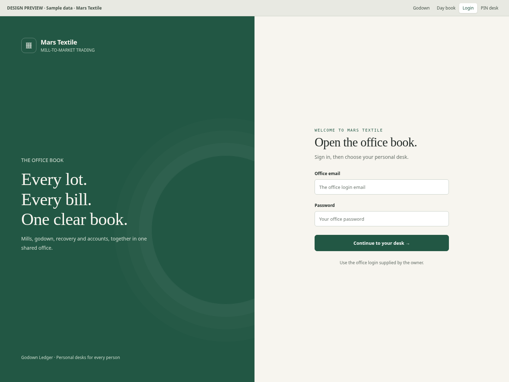
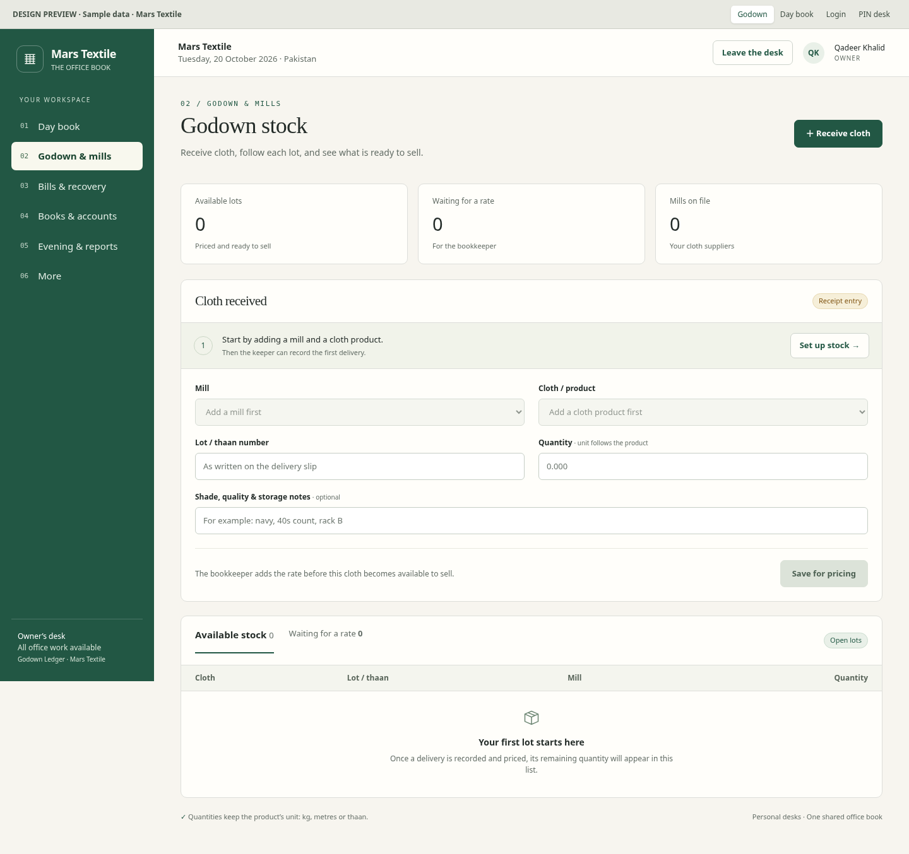

# Mars Textile · Visual proposal

A separate preview of the proposed warm-white and deep-green design. The live application has not been changed. Figures are sample zero states, and this preview is not connected to a database.

The uploaded Grok prototype's visual source was reviewed: paper backgrounds, serif headings, simple bordered panels and compact numbered navigation. This proposal uses those ideas with Mars Textile branding, a woven-grid mark and the agreed green palette.

## Login

## Godown stock

## Other screens

- [Owner day book](day-book-desktop.png)
- [Personal PIN desk](pin-desktop.png)
- [Mobile godown screen](godown-mobile.png)
- [Full redesign plan and implementation stages](PLAN.md)

## Interactive version

Download this branch with **Code → Download ZIP**, unzip it, and open `design/mars-textile/index.html` in your browser. The screen switcher at the top changes between Godown, Day book, Login and PIN desk. Forms are visual examples only; never enter actual credentials into this prototype.

## Checks performed

All four screens, screen switching, the mobile navigation drawer and 390px page width were checked in Chromium. No browser JavaScript errors occurred. Core text contrast ratios were checked: secondary text 5.00:1, main text 14.18:1, white on green 8.35:1 and amber text 5.66:1. These are selected colour checks, not a complete accessibility audit.

No application routes, business data, database schema, server authorization or production deployment configuration were changed by this preview.
