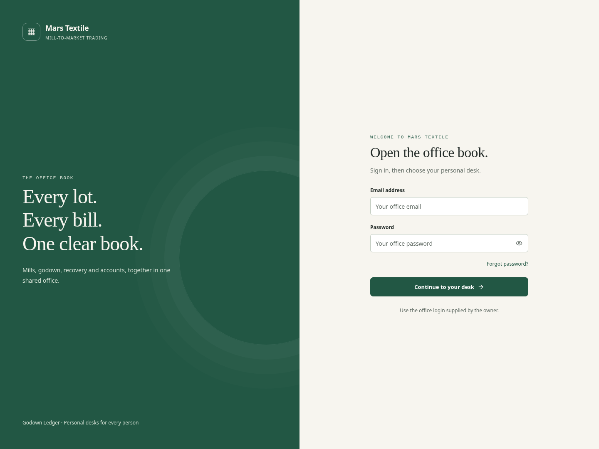
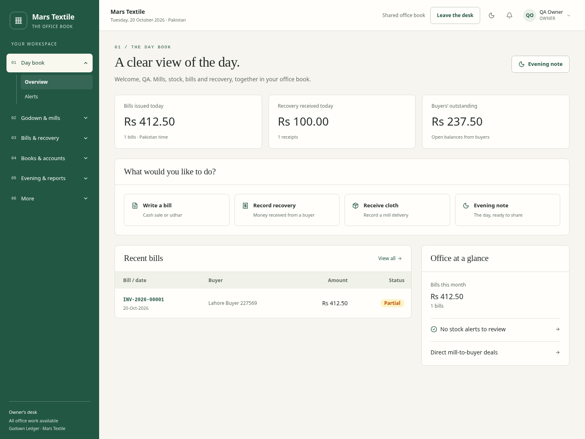
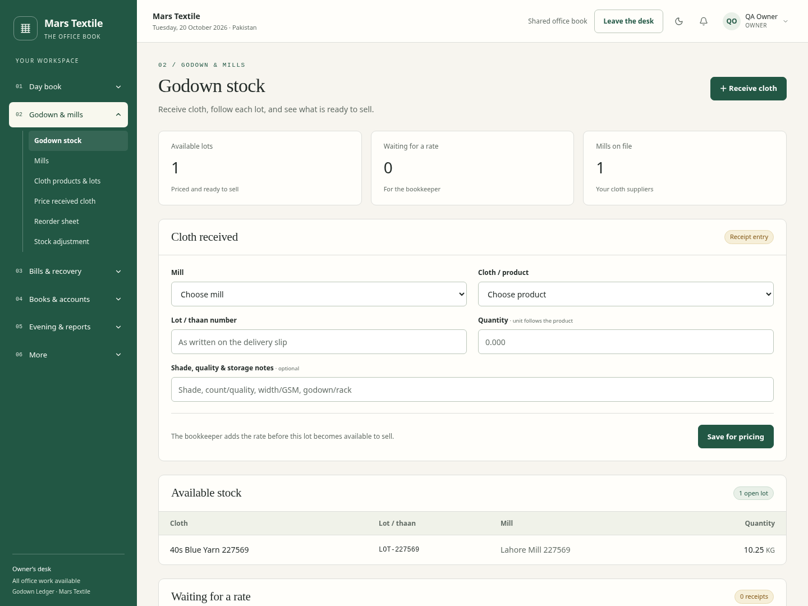

# Implemented Mars Textile design

These are screenshots of the working Next.js production build, following approval of the original proposal. They use a separate local QA database with synthetic people and transactions. They are not screenshots of client production records.

## Login

## Owner day book

## Godown

[Personal PIN screen](pin.png) · [Mobile godown](godown-mobile.png) · [Sales bills](bills.png) · [Evening note](evening.png)

The production build, 57 unit tests, complete browser workday, two-computer updates, role access, mobile navigation, theme switching and bill PDF printing were checked. See [release details](../../../docs/VISUAL-RELEASE.md).
